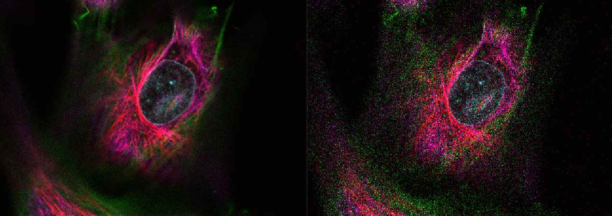
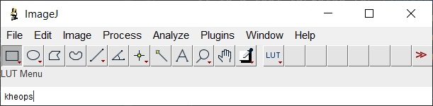
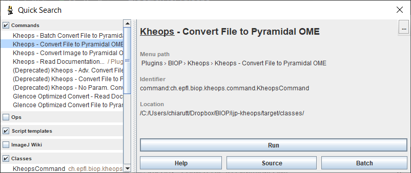
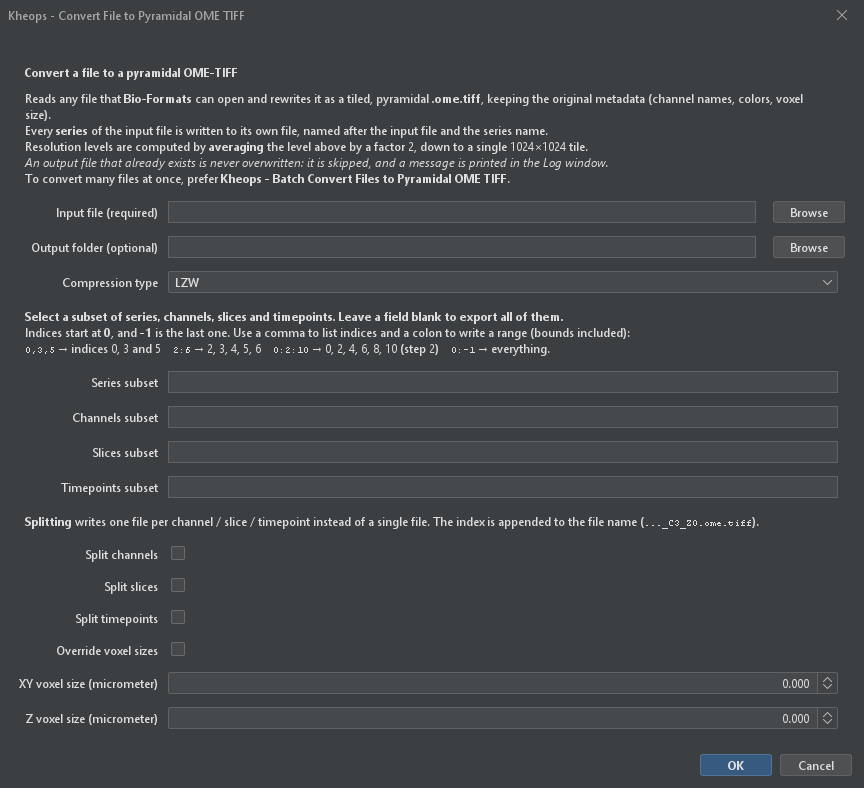
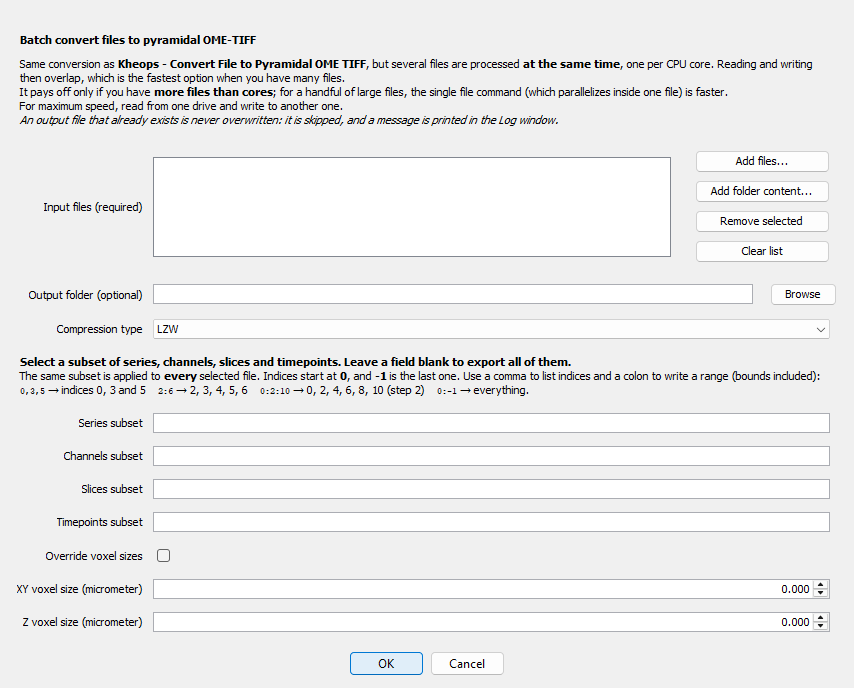
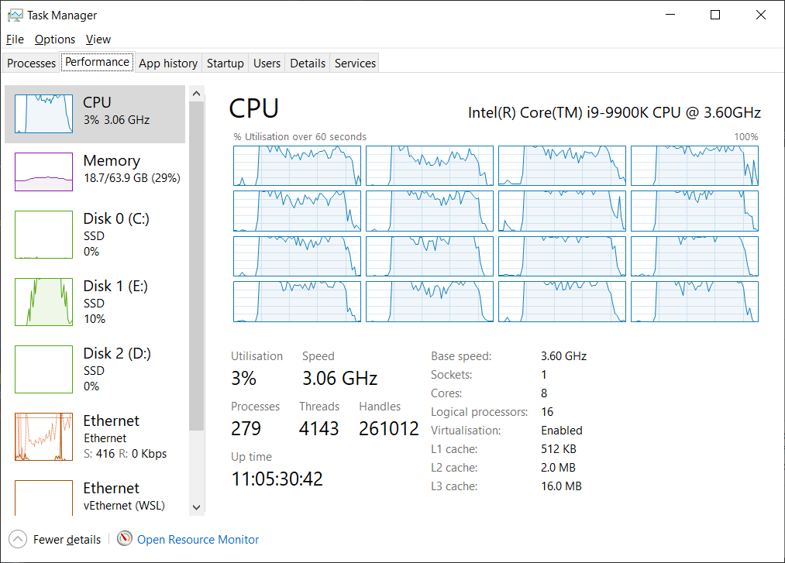
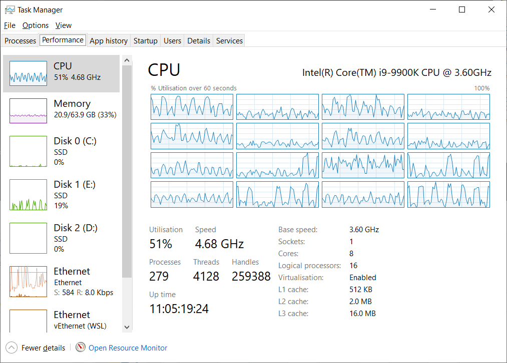
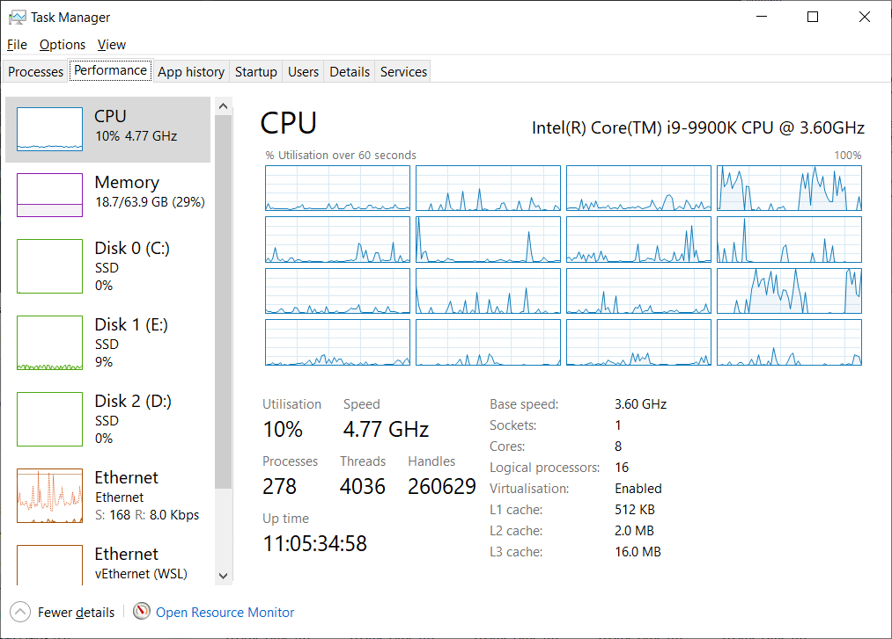

[](https://github.com/BIOP/ijp-kheops/actions/workflows/build-main.yml)
[](https://maven.scijava.org/#browse/browse:releases:ch%2Fepfl%2Fbiop%2Fijp-kheops)


**Kheops** is an ImageJ/Fiji plugin that **converts Bio-Formats readable files to pyramidal ome.tiff** files. It can also be used to save an opened image to a pyramidal ome.tiff file.

It has been tested on 8-bit and 16 bits fluorescent images as well as 24-bits RGB images. Multi-series files are also supported: each image is exported to an individual ome.tiff file.

If the original file is not calibrated, you can specify the physical pixel size for the exported file (and that would be a very good idea).

During the 'pyramidisation', downscaled images are generated by computing an average (in XY) over the previous higher resolution scale, and not by picking a single pixel value (nearest neighbor: NN). This leads to high SNR of low resolution scaled versions (left: Average, right: NN):



## Install

It is a tool targeted for [ImageJ/Fiji](https://imagej.net/software/fiji/). It can be installed through the [PTBIOP update site](https://wiki-biop.epfl.ch/en/ipa/fiji/update-site).

## Convert A Single File to Pyramidal OME TIFF

1. Use the Fiji search bar and type `kheops`



2. Select `Kheops - Convert File to Pyramidal OME`



3. Click `Run`



 - **Select an input file (required)**: Select the file you want to convert to a pyramidal ome.tiff 
 - **Specify an output folder (optional)**: By default, it will save the ome.tiff in the same folder 
 - **Override voxel sizes**: if your original file is not calibrated, NOW is the occasion to set the correct pixel size. Note that if the image is a multi-series image, all images will have the same voxel size.
 - **Voxel size in micrometer (XY)**: if `Override voxel sizes` is checked, the output images will use this value to set the voxel size along the X and Y dimension
- **Voxel size in micrometer (Z)**: if `Override voxel sizes` is checked, the output images will use this value to set the voxel size along the Z dimension

For the sake of simplicity, only a few saving parameters are left to the users. The output file is compressed using lzw compression, tiled with a tile size of 512x512, and pyramidal levels are computed with a downscaling factor 2 until the top level is a single tile (X or Y dimension below 512 pixels).

## Batch Convert Files to Pyramidal OME TIFF </h3> 

If you need to convert several files, this is the preferred command. It can be very fast because all cores are used and each core is processing a single file. Reading and writing can thus happen in parallel. For maximum speed, you may choose a different drive between inputs and outputs.

1. Use the Fiji search bar and type `kheops`
2. Select `Kheops - Batch Convert File to Pyramidal OME`
3. Click `Run`



4. Select the images to convert in the file array widget, the other options are identical to the single file mode. 

## Kheops - Convert Image to Pyramidal OME

This command converts the currently opened Image to a pyramidal ome.tiff file. Contrary to the file conversion commands, the image will not be tiled.

## Kheops - Read Documentation ...
You arrive at this page.

## Macro Language Code Example

```
//@File(Label="Select a file", style="" ) input_path
output_dir = File.getParent(input_path);

run("Kheops - Convert File to Pyramidal OME", "input_path=["+input_path+"] output_dir=["+output_dir+"] override_voxel_size=false vox_size_xy=0.0 vox_size_z=0.0");
```

# Alternative to Kheops, differences and benchmark

Two other tools do the same job:

- [**`bftools`**](https://bio-formats.readthedocs.io/en/latest/users/comlinetools/index.html)
  uses the same Bio-Formats readers and writers Kheops is built on, single
  threaded.
- [**OME NGFF Converter**](https://www.glencoesoftware.com/products/ngff-converter/)
  (Glencoe) runs `bioformats2raw` to write an intermediate OME-NGFF, then
  `raw2ometiff` to turn it into a pyramidal OME-TIFF.

Kheops parallelizes wherever it can, and writes the OME-TIFF directly, with no
intermediate on disk. Reading is parallelized; on the writing side each series
of a multi-series file, and each file of a batch, is converted on its own
thread.

> **If you use OME NGFF Converter, select `LINEAR` downsampling.** Its default
> picks a single pixel out of each block (nearest neighbour), which gives
> visibly noisy low resolution levels. Kheops always averages.

Here is a comparison of Kheops (left) and nearest-neighbour downsampling (right):


## Benchmark

Measured 24 August 2026 on one machine: Windows 11, 32 logical processors,
Java 21, Bio-Formats 8.5.0, input and output both on the same NVMe SSD. All
inputs are synthetic, uncompressed, tiled OME-TIFFs generated by the benchmark
itself, so they can be reproduced without downloading anything - see
[BENCHMARKS.md](BENCHMARKS.md). Both tools wrote LZW pyramids with a downsample
factor of 2, configured to match as closely as the two tools allow.

| dataset | raw size | levels | **Kheops** | OME NGFF Converter | speed-up |
| --- | ---: | ---: | ---: | ---: | ---: |
| one 22000x16000 image, 3 channels | 2.0 GB | 5 | **9.5 s** | 22.6 s | **x2.4** |
| one 32000x32000 plane | 1.9 GB | 6 | **9.4 s** | 20.6 s | **x2.2** |
| 16 series of 8192x8192 | 2.0 GB | 4 | **10.5 s** | 22.6 s | **x2.1** |
| 2500 planes of 1024x1024 (1250 t, 2 ch) | 5.0 GB | 1 | **10.8 s** | 46.9 s | **x4.4** |
| one 32000x32000 plane, no pyramid | 1.9 GB | 1 | **3.1 s** | 14.5 s | **x4.6** |

In megapixels per second, counting every pixel written, pyramid included:

| dataset | **Kheops** | OME NGFF Converter |
| --- | ---: | ---: |
| one 22000x16000 image, 3 channels | **148 MPix/s** | 62 MPix/s |
| one 32000x32000 plane | **145 MPix/s** | 66 MPix/s |
| 16 series of 8192x8192 | **136 MPix/s** | 63 MPix/s |
| 2500 planes of 1024x1024 | **244 MPix/s** | 56 MPix/s |
| one 32000x32000 plane, no pyramid | **325 MPix/s** | 71 MPix/s |

Kheops is between **x2.1 and x4.6** faster on these images. The gap is smallest
on ordinary pyramids and largest on the two cases that write many TIFF
directories or no pyramid at all, where the fixed cost of the intermediate NGFF
is not amortised by pyramid work.

That intermediate is most of the difference. Splitting the converter's own log
into its two stages:

| dataset | `bioformats2raw` | `raw2ometiff` | total |
| --- | ---: | ---: | ---: |
| one 22000x16000 image, 3 channels | 8.6 s | 13.7 s | 22.6 s |
| one 32000x32000 plane | 7.2 s | 13.1 s | 20.6 s |
| 16 series of 8192x8192 | 8.0 s | 14.1 s | 22.6 s |
| 2500 planes of 1024x1024 | 12.4 s | 30.0 s | 46.9 s |
| one 32000x32000 plane, no pyramid | 4.4 s | 9.9 s | 14.5 s |

Every dataset is written twice - once as NGFF chunks, once as OME-TIFF - and the
chunks are then deleted. Kheops writes the output once. It does keep one
temporary file while building a pyramid, which is why its own no-pyramid row is
about x3 faster than its pyramid row: removing that round trip is the largest
optimisation still open, and is tracked in [BENCHMARKS.md](BENCHMARKS.md).

**How to read these numbers.** The Kheops timings are the median of 3 runs after
a warm-up, all measured in one JVM. The OME NGFF Converter timings are a single
run each, taken from its log, so they carry no spread. Two runs of the Kheops
table half an hour apart differed by 2 to 10 %, which is the right order of
confidence to attach to a single measurement: the two- and four-fold differences
above are well outside it, but nothing should be read into a 10 % gap. Both
tools ran on an otherwise idle machine, reading from and writing to the same
drive.

<details>
<summary>Earlier benchmarks (2022, different machine, real acquisition files)</summary>
<br>

These are kept for reference. They were measured on a 16 core Intel i9-9900K
running Windows 10, on real files rather than synthetic ones, and against the
Glencoe workflow and `bftools` rather than the current OME NGFF Converter. They
are not comparable with the tables above.

### Single file, single series

`Fibroblasts-007.lif`, 4.18 GB uncompressed (4096 x 4096, 4 channels, 67 slices,
8 bits). Four resolution levels, factor 2, LZW.

| File Size | #Input files | # Output files | Method                       | Downsampling Method | Run time | Effective speed (Mo/s) |
|-----------|--------------|----------------|------------------------------|---------------------|----------|------------------------|
| 4.18 GB   | 1            | 1              | **Kheops**                   | Average             | 133s     | **32.2 Mo/s**          |
| 4.18 GB   | 1            | 1              | Glencoe                      | NN                  | 41s      | 104.4 Mo/s             |
| 4.18 GB   | 1            | 1              | Kheops deprecated (~bftools) | NN                  | 142s     | 30.1 Mo/s              |

| File Size | Method  | Downsampling Method | Condition                                 | Run time | Effective speed (Mo/s) |
|-----------|---------|---------------------|-------------------------------------------|----------|------------------------|
| 4.18 GB   | Glencoe | NN                  | -                                         | 41s      | 104.4 Mo/s             |
| 4.18 GB   | Kheops  | -                   | no pyramid                                | 61s      | 70.2 Mo/s              |
| 4.18 GB   | Kheops  | Average             | no compression                            | 153s!    | 28 Mo/s                |
| 4.18 GB   | Kheops  | -                   | no pyramid & no compression               | 53s      | 80.8 Mo/s              |
| 4.18 GB   | Kheops  | Average             | tile = 1024 (not 512)                     | 96s      | 44.6 Mo/s              |
| 4.18 GB   | Kheops  | -                   | tile = 1024 & no pyramid & no compression | 40s      | 107.0 Mo/s             |

### Single file, multi series

`ConvalariaTiles.lif`, 81 tiles of 2048 x 1536 RGB. Three resolution levels, LZW.

| File Size | #Input files | # Output files | Method | Downsampling Method | Run time | Effective speed (Mo/s) |
|-----------| --- | --- | --- | --- | --- | --- |
| 729 Mo    | 1 | 81 | **Kheops** | Average | 5s | **146 Mo/s** |
| 729 Mo    | 1 | 1 | Glencoe | NN | 28s | 26 Mo/s |
|  729 Mo   | 1 | 1 | Kheops deprecated (~bftools)  | NN | 27s | 27 Mo/s |

### Multiple files

15 images of typically 15k x 10k, 2 channels, 16 bits, 9.2 GB total, 6
resolution levels, LZW.

| Files Size | #Input files | # Output files | Method                       | Downsampling Method | Run time | Effective speed (Mo/s) |
|------------|--------------|----------------|------------------------------|---------------------|----------|------------------------|
| 9.2 Go     | 15           | 15             | **Kheops**                   | Average             | 47s      | 200 Mo/s               |
| 9.2 Go     | 15           | 15             | Glencoe                      | NN                  | 142s     | 66 Mo/s                |
| 9.2 Go     | 15           | 15             | Kheops deprecated (~bftools) | NN                  | 270s     | 34.9 Mo/s              |

Kheops uses one thread per file and saturates the drive:


Glencoe parallelizes less efficiently on a single file:


`bftools` is single threaded:


</details>

# Deprecated Kheops Command

This repository used to directly wrap `bftools` from bio-formats, but it has been modified for performance and simplicity. You can still access the deprecated function and the legacy documentation can be [found here](https://github.com/BIOP/ijp-kheops/blob/ac323c324e6db86d5ef614296d4388fc438d8e05/README.md).


