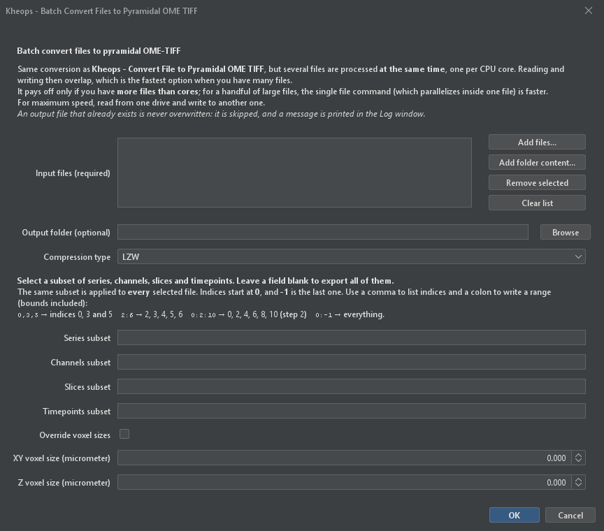
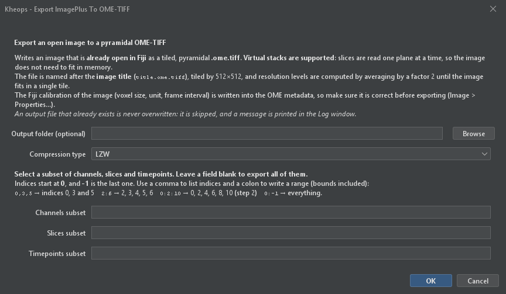
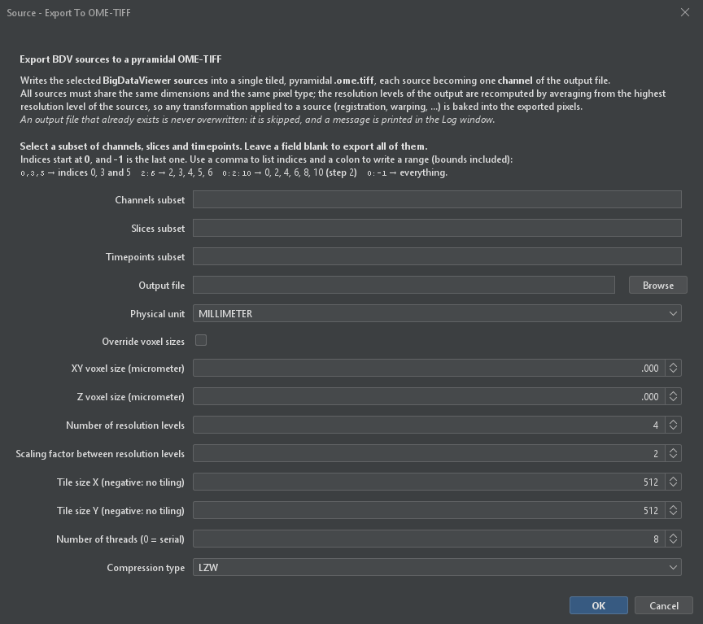

[](https://github.com/BIOP/ijp-kheops/actions/workflows/build-main.yml)
[](https://maven.scijava.org/#browse/browse:releases:ch%2Fepfl%2Fbiop%2Fijp-kheops)


**Kheops** is an ImageJ/Fiji plugin that converts any **Bio-Formats readable file into a pyramidal OME-TIFF**, and it is fast: on the images we measured, **x2.1 to x4.6 faster** than the OME NGFF Converter ([see the benchmark](#benchmark)).

- Every **series** of a multi-series file is written to its own OME-TIFF.
- Tested on 8-bit and 16-bit fluorescent images, and on 24-bit RGB images.
- Files, **images already open in Fiji** (virtual stacks included), and BigDataViewer sources can all be converted.
- If your file is not calibrated, you can set the physical pixel size while converting - and you really should.

Resolution levels are built by **averaging** each 2x2 block of the level above, not by picking one pixel out of it (nearest neighbour). Low resolution levels stay clean instead of getting noisy - left: average, right: nearest neighbour:


## Contents

- [Install](#install)
- [Convert a file](#convert-a-file)
- [Batch convert files](#batch-convert-files)
- [Export an image already open in Fiji](#export-an-image-already-open-in-fiji)
- [Export BigDataViewer sources](#export-bigdataviewer-sources)
- [Read the documentation](#read-the-documentation)
- [Scripting](#scripting)
- [Command line](#command-line)
  - [Parameters](#parameters)
  - [From a script instead](#from-a-script-instead)
- [How Kheops compares](#how-kheops-compares)
  - [Benchmark](#benchmark)

## Install

Kheops targets [ImageJ/Fiji](https://imagej.net/software/fiji/) and is installed through the [PTBIOP update site](https://wiki-biop.epfl.ch/en/ipa/fiji/update-site).

To run any command below, type `kheops` in the Fiji search bar, select the command, and click `Run`. They also live in the menu, under `Plugins > BIOP > Kheops`.

Every field in every dialog has a tooltip, and each dialog opens with a short description of what it does, so the sections below only cover what needs more than one line.

## Convert a file

`Plugins > BIOP > Kheops > Kheops - Convert File to Pyramidal OME TIFF`

Converts one file. Use this one by default.


- **Input file**: any format Bio-Formats can open (`.czi`, `.lif`, `.nd2`, `.vsi`, `.svs`, `.ome.tiff`, ...). Each series it contains becomes its own output file.
- **Output folder**: leave empty to write next to the input file.
- **Compression**: `LZW` is lossless and a good default. `Uncompressed` is the fastest to write and the biggest. `JPEG-2000` is lossless but slow, while `JPEG-2000 Lossy` and `JPEG` give the smallest files but modify the pixel values.
- **Subsets**: leave blank to export everything. Indices start at 0, `-1` is the last one, a comma lists indices (`0,3,5`) and a colon writes a range with both bounds included (`2:6`, or `0:2:10` for a step of 2).
- **Split channels / slices / timepoints**: writes one file per channel, slice or timepoint, with the index appended to the file name.
- **Override voxel sizes**: if your file is not calibrated, NOW is the occasion to set the correct pixel size. In a multi-series file, all series get the same voxel size.

The output is tiled 1024x1024 and compressed with LZW by default, and resolution levels are computed with a downscaling factor 2 until the top level fits in a single tile.

An output file that already exists is never overwritten: it is skipped, and a message is printed in the Log window.

## Batch convert files

`Plugins > BIOP > Kheops > Kheops - Batch Convert Files to Pyramidal OME TIFF`

Converts many files at once, one per CPU core, so reading and writing overlap. The options are the same as above, and the subset fields apply the same selection to every file.



This only pays off if you have **more files than cores**. For a handful of large files, the single file command, which parallelizes inside one file, is faster. For maximum speed, read from one drive and write to another one. Note that this command tiles by 512x512 rather than 1024x1024.

## Export an image already open in Fiji

`Plugins > BIOP > Kheops > Kheops - Export ImagePlus To OME-TIFF`



The image does not need to fit in memory: **virtual stacks are supported**, and their planes are read one at a time as the export progresses.

The file is named after the image title (`title.ome.tiff`), and the output folder is optional - leave it empty and the file is written next to the file the image was opened from. An image that is not backed by a file (freshly created, screen capture, ...) has no such folder, so there you do need to give one.

The voxel size, the unit and the frame interval written in the OME metadata come from the Fiji calibration of the image, so check `Image > Properties...` before exporting.

## Export BigDataViewer sources

`Plugins > BigDataViewer-Playground > Export > Source - Export To OME-TIFF`

Saves the selected BigDataViewer sources into a single OME-TIFF, each source becoming one channel of the output file.



All sources must share the same dimensions and the same pixel type. The resolution levels are recomputed by averaging from the highest resolution level of the sources, so any transformation applied to a source (registration, warping, ...) is baked into the exported pixels.

Contrary to the commands above, this one exposes the writing parameters: number of resolution levels, downscaling factor, tile size and number of threads.

## Read the documentation

`Plugins > BIOP > Kheops > Kheops - Read Documentation...` opens this page in your browser.

## Scripting

All commands are recordable and scriptable. From the ImageJ macro language:

```
//@File(Label="Select a file", style="" ) input_path
output_dir = File.getParent(input_path);

run("Kheops - Convert File to Pyramidal OME TIFF", "input_path=["+input_path+"] output_dir=["+output_dir+"] compression=LZW override_voxel_size=false vox_size_xy=0.0 vox_size_z=0.0");
```

## Command line

Fiji runs Kheops without opening a window, which is what you want for a cluster job, a nightly conversion or a CI pipeline. The command is named by its menu entry and the parameters by the names below.

Convert one file, next to the input, with the defaults:

```bash
# Linux / macOS
/opt/Fiji.app/ImageJ-linux64 --headless --console \
  --run "Kheops - Convert File to Pyramidal OME TIFF" \
  "input_path='/data/slide.czi'"
```

```bat
REM Windows
"C:\Fiji\fiji.bat" --headless --console --run "Kheops - Convert File to Pyramidal OME TIFF" "input_path='F:/image.ome.tiff',compression='LZW'"
```

The launcher is named differently depending on how old your Fiji is: `fiji.bat` or `fiji-windows-x64.exe` on Windows, `fiji-linux-x64` or `ImageJ-linux64` on Linux, `fiji-macos-arm64` or `ImageJ-macosx` on macOS. **Use forward slashes in paths**, on Windows too: a backslash inside the parameter string is read as an escape.

Choose the output folder and the compression:

```bash
/opt/Fiji.app/ImageJ-linux64 --headless --console \
  --run "Kheops - Convert File to Pyramidal OME TIFF" \
  "input_path='/data/slide.czi',output_dir='/data/converted',compression='JPEG-2000'"
```

Set the voxel size of an uncalibrated file, and convert only its first series:

```bash
/opt/Fiji.app/ImageJ-linux64 --headless --console \
  --run "Kheops - Convert File to Pyramidal OME TIFF" \
  "input_path='/data/slide.czi',subset_series='0',override_voxel_size=true,vox_size_xy=0.325,vox_size_z=1.0"
```

Convert a whole folder, one file at a time:

```bash
for f in /data/*.czi; do
  /opt/Fiji.app/ImageJ-linux64 --headless --console \
    -Dimagej.updater.disableAutocheck=true \
    --run "Kheops - Convert File to Pyramidal OME TIFF" \
    "input_path='$f',output_dir='/data/converted'"
done
```

`-Dimagej.updater.disableAutocheck=true` stops Fiji from pinging the update sites on every launch, which matters once you loop.

> **The batch command cannot be driven from the command line.** Its `input_paths` parameter is a list of files (`File[]`), and there is no syntax for passing one through `--run`. Loop over the single file command instead, as above. You lose nothing: the single file command already uses every core, and the batch command is only faster when it has more files than cores to work on at once.

### Parameters

Same names as in the macro recorder. Everything except `input_path` is optional.

| parameter | example | meaning |
| --- | --- | --- |
| `input_path` | `'/data/slide.czi'` | the file to convert (required) |
| `output_dir` | `'/data/converted'` | output folder; defaults to the input's folder |
| `compression` | `'LZW'` | `LZW`, `Uncompressed`, `JPEG-2000`, `JPEG-2000 Lossy`, `JPEG` |
| `subset_series` | `'0'` | which series to convert; blank means all |
| `subset_channels` | `'0,2'` | which channels to keep |
| `subset_slices` | `'0:10'` | which Z slices to keep |
| `subset_frames` | `'0:2:-1'` | which timepoints to keep |
| `split_channels` | `true` | one file per channel |
| `split_slices` | `true` | one file per Z slice |
| `split_frames` | `true` | one file per timepoint |
| `override_voxel_size` | `true` | use the two values below instead of the file's calibration |
| `vox_size_xy` | `0.325` | XY voxel size in micrometer |
| `vox_size_z` | `1.0` | Z voxel size in micrometer |

Quote the values that contain a space, `JPEG-2000 Lossy` in particular. `--console` sends the Kheops log to stdout, so conversion errors - an unreadable file, an output that already exists - show up in the terminal rather than disappearing.

### From a script instead

`--run` accepts a script path just as well as a menu name, which is handier once the conversion is one step of something larger, and refers to the command by its class rather than by a name that could be renamed:

```groovy
// kheops.groovy
#@ File input_path
#@ File (style = "directory") output_dir
#@ CommandService cs

cs.run(ch.epfl.biop.kheops.command.KheopsCommand.class, true,
       "input_path", input_path,
       "output_dir", output_dir,
       "compression", "LZW").get()
```

```bash
/opt/Fiji.app/ImageJ-linux64 --headless --console \
  --run kheops.groovy "input_path='/data/slide.czi',output_dir='/data/converted'"
```

The `.get()` matters: without it the script returns before the conversion is finished.

# How Kheops compares

Two other tools do the same job:

- [**`bftools`**](https://bio-formats.readthedocs.io/en/latest/users/comlinetools/index.html)
  uses the same Bio-Formats readers and writers Kheops is built on, single
  threaded.
- [**OME NGFF Converter**](https://www.glencoesoftware.com/products/ngff-converter/)
  (Glencoe) runs `bioformats2raw` to write an intermediate OME-NGFF, then
  `raw2ometiff` to turn it into a pyramidal OME-TIFF.

Kheops parallelizes wherever it can, and writes the OME-TIFF directly, with no
intermediate on disk. Reading is parallelized; on the writing side each series
of a multi-series file, and each file of a batch, is converted on its own
thread.

> **If you use OME NGFF Converter, select `LINEAR` downsampling.** Its default
> picks a single pixel out of each block (nearest neighbour), which gives
> visibly noisy low resolution levels. Kheops always averages.

## Benchmark

Measured 24 August 2026 on one machine: Windows 11, 32 logical processors,
Java 21, Bio-Formats 8.5.0, input and output both on the same NVMe SSD. All
inputs are synthetic, uncompressed, tiled OME-TIFFs generated by the benchmark
itself, so they can be reproduced without downloading anything - see
[BENCHMARKS.md](BENCHMARKS.md). Both tools wrote LZW pyramids with a downsample
factor of 2, configured to match as closely as the two tools allow.

| dataset | raw size | levels | **Kheops** | OME NGFF Converter | speed-up |
| --- | ---: | ---: | ---: | ---: | ---: |
| one 22000x16000 image, 3 channels | 2.0 GB | 5 | **9.5 s** | 22.6 s | **x2.4** |
| one 32000x32000 plane | 1.9 GB | 6 | **9.4 s** | 20.6 s | **x2.2** |
| 16 series of 8192x8192 | 2.0 GB | 4 | **10.5 s** | 22.6 s | **x2.1** |
| 2500 planes of 1024x1024 (1250 t, 2 ch) | 5.0 GB | 1 | **10.8 s** | 46.9 s | **x4.4** |
| one 32000x32000 plane, no pyramid | 1.9 GB | 1 | **3.1 s** | 14.5 s | **x4.6** |

In megapixels per second, counting every pixel written, pyramid included:

| dataset | **Kheops** | OME NGFF Converter |
| --- | ---: | ---: |
| one 22000x16000 image, 3 channels | **148 MPix/s** | 62 MPix/s |
| one 32000x32000 plane | **145 MPix/s** | 66 MPix/s |
| 16 series of 8192x8192 | **136 MPix/s** | 63 MPix/s |
| 2500 planes of 1024x1024 | **244 MPix/s** | 56 MPix/s |
| one 32000x32000 plane, no pyramid | **325 MPix/s** | 71 MPix/s |

Kheops is between **x2.1 and x4.6** faster on these images. The gap is smallest
on ordinary pyramids and largest on the two cases that write many TIFF
directories or no pyramid at all, where the fixed cost of the intermediate NGFF
is not amortised by pyramid work.

That intermediate is most of the difference. Splitting the converter's own log
into its two stages:

| dataset | `bioformats2raw` | `raw2ometiff` | total |
| --- | ---: | ---: | ---: |
| one 22000x16000 image, 3 channels | 8.6 s | 13.7 s | 22.6 s |
| one 32000x32000 plane | 7.2 s | 13.1 s | 20.6 s |
| 16 series of 8192x8192 | 8.0 s | 14.1 s | 22.6 s |
| 2500 planes of 1024x1024 | 12.4 s | 30.0 s | 46.9 s |
| one 32000x32000 plane, no pyramid | 4.4 s | 9.9 s | 14.5 s |

Every dataset is written twice - once as NGFF chunks, once as OME-TIFF - and the
chunks are then deleted. Kheops writes the output once. It does keep one
temporary file while building a pyramid, which is why its own no-pyramid row is
about x3 faster than its pyramid row: removing that round trip is the largest
optimisation still open, and is tracked in [BENCHMARKS.md](BENCHMARKS.md).

**How to read these numbers.** The Kheops timings are the median of 3 runs after
a warm-up, all measured in one JVM. The OME NGFF Converter timings are a single
run each, taken from its log, so they carry no spread. Two runs of the Kheops
table half an hour apart differed by 2 to 10 %, which is the right order of
confidence to attach to a single measurement: the two- and four-fold differences
above are well outside it, but nothing should be read into a 10 % gap. Both
tools ran on an otherwise idle machine, reading from and writing to the same
drive.

